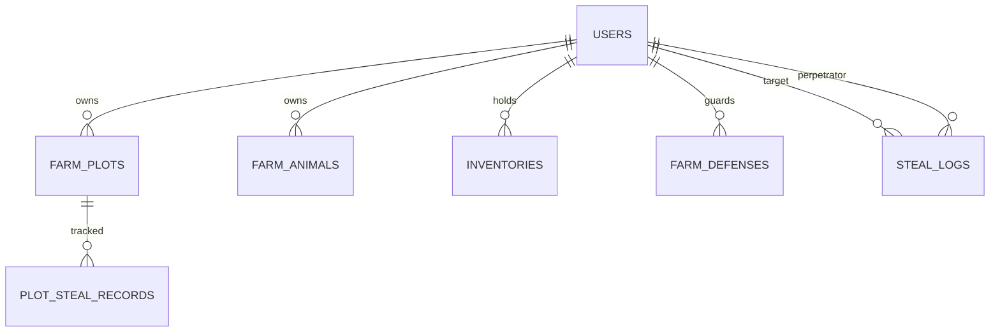

# Database & Online System Specification: Farm RPG & Thievery Mechanics (Cơ Chế Ăn Trộm)

> **Document Type:** Backend Architecture & Database Schema  
> **Key Modules:** Farm State Management, Timestamp-based Simulation, Thievery Engine, Anti-Race Condition, Guard Dog Defense, Activity Logs.  
> **Recommended Stack:** PostgreSQL (ACID Transactions for Anti-cheat/Double-stealing) + Redis (Real-time Caching) + Node.js (Express/Fastify) or Go.

---

## 1. Nguyên Lý Thiết Kế Online (Server-Authoritative)

### 1.1 Tính Toán Tăng Trưởng Dựa Trên Timestamp (Không dùng Timer Client)
- **Không bao giờ** cho client tự gửi lên "Cây tôi đã chín rồi, cộng tiền đi".
- Mọi trạng thái tính theo công thức:
  $$\text{CurrentStage} = \min\left(\text{MaxStages}, \left\lfloor \frac{\text{Now} - \text{PlantedAt}}{\text{StageDurationSeconds}} \right\rfloor \right)$$
- Khi cây đạt $\text{CurrentStage} = \text{MaxStages}$, trạng thái chuyển thành `HARVESTABLE`.

### 1.2 Chống Lỗi Race Condition Khi Ăn Trộm (Double Stealing)
Nếu 2 người bạn cùng bấm vào trộm 1 củ cà rốt tại cùng một mili-giây:
- Bắt buộc dùng **Database Transaction** với khóa hàng:
  ```sql
  -- Khóa dòng dữ liệu ô đất để xử lý tuần tự
  SELECT * FROM farm_plots WHERE id = $plotId FOR UPDATE;
  ```
- Hoặc dùng **Redis Distributed Lock** (`SET lock:plot:123 NX EX 2`) trước khi xử lý logic ăn trộm.

---

## 2. Bảng Cơ Sở Dữ Liệu Chi Tiết (PostgreSQL / Relational Schema)



### 2.1 Bảng `users` (Thông tin người chơi)
```sql
CREATE TABLE users (
    id UUID PRIMARY KEY DEFAULT gen_random_uuid(),
    username VARCHAR(50) UNIQUE NOT NULL,
    avatar_url TEXT,
    level INT DEFAULT 1,
    exp INT DEFAULT 0,
    gold BIGINT DEFAULT 500,
    energy INT DEFAULT 100,
    max_energy INT DEFAULT 100,
    last_login_at TIMESTAMP WITH TIME ZONE DEFAULT NOW(),
    created_at TIMESTAMP WITH TIME ZONE DEFAULT NOW()
);
```

### 2.2 Bảng `farm_plots` (Từng ô đất trồng cây)
```sql
CREATE TABLE farm_plots (
    id UUID PRIMARY KEY DEFAULT gen_random_uuid(),
    user_id UUID REFERENCES users(id) ON DELETE CASCADE,
    plot_index INT NOT NULL, -- Vị trí ô đất trên grid (0, 1, 2... 24)
    crop_id VARCHAR(50),     -- NULL nếu đất trống ('crop_strawberry', 'crop_wheat'...)
    planted_at TIMESTAMP WITH TIME ZONE,
    watered_at TIMESTAMP WITH TIME ZONE,
    is_watered BOOLEAN DEFAULT FALSE,
    
    -- Các trường phục vụ cơ chế ăn trộm:
    original_yield INT DEFAULT 0,  -- Sản lượng gốc lúc chín (ví dụ: 10 trái)
    remaining_yield INT DEFAULT 0, -- Sản lượng thực tế còn lại (ví dụ: bị trộm mất 3 còn 7)
    stolen_count INT DEFAULT 0,    -- Đã bị trộm bao nhiêu trái
    max_stealable INT DEFAULT 0,   -- Giới hạn tối đa có thể bị trộm (VD: 30% của original_yield = 3 trái)
    is_harvested BOOLEAN DEFAULT FALSE,
    
    UNIQUE(user_id, plot_index)
);
```

### 2.3 Bảng `farm_animals` (Vật nuôi trong chuồng)
```sql
CREATE TABLE farm_animals (
    id UUID PRIMARY KEY DEFAULT gen_random_uuid(),
    user_id UUID REFERENCES users(id) ON DELETE CASCADE,
    animal_id VARCHAR(50) NOT NULL, -- 'animal_chicken', 'animal_cow'...
    nickname VARCHAR(50),
    growth_stage VARCHAR(20) DEFAULT 'baby', -- 'baby', 'adult'
    bought_at TIMESTAMP WITH TIME ZONE DEFAULT NOW(),
    last_fed_at TIMESTAMP WITH TIME ZONE,
    last_petted_at TIMESTAMP WITH TIME ZONE,
    affection_points INT DEFAULT 0, -- Điểm tim tình cảm (0 - 1000)
    
    -- Sản phẩm chu kỳ:
    product_ready_at TIMESTAMP WITH TIME ZONE,
    has_product BOOLEAN DEFAULT FALSE,
    product_stolen BOOLEAN DEFAULT FALSE -- Đã bị người khác vắt sữa / nhặt trứng trộm chưa
);
```

### 2.4 Bảng `farm_defenses` (Hệ thống chó giữ nhà & bẫy trộm)
```sql
CREATE TABLE farm_defenses (
    user_id UUID PRIMARY KEY REFERENCES users(id) ON DELETE CASCADE,
    dog_name VARCHAR(50) DEFAULT 'Vàng',
    dog_level INT DEFAULT 1,            -- Level càng cao, tỉ lệ cắn trộm & tiền phạt càng lớn
    bite_rate DECIMAL(3, 2) DEFAULT 0.35, -- 35% xác suất phát hiện & cắn kẻ trộm
    is_fed BOOLEAN DEFAULT TRUE,         -- Chó phải được cho ăn xương/thịt thì mới sủa/cắn
    bone_count INT DEFAULT 5             -- Số lượt sủa/bảo vệ còn lại
);
```

### 2.5 Bảng `plot_steal_records` (Kiểm soát 1 người chỉ trộm 1 lần/mẻ)
```sql
CREATE TABLE plot_steal_records (
    id UUID PRIMARY KEY DEFAULT gen_random_uuid(),
    plot_id UUID REFERENCES farm_plots(id) ON DELETE CASCADE,
    thief_id UUID REFERENCES users(id) ON DELETE CASCADE,
    quantity_stolen INT NOT NULL,
    stolen_at TIMESTAMP WITH TIME ZONE DEFAULT NOW(),
    UNIQUE(plot_id, thief_id) -- Chống 1 người spam trộm cùng 1 luống nhiều lần
);
```

### 2.6 Bảng `steal_logs` (Nhật ký trộm - Thông báo cho người bị hại)
```sql
CREATE TABLE steal_logs (
    id UUID PRIMARY KEY DEFAULT gen_random_uuid(),
    victim_id UUID REFERENCES users(id) ON DELETE CASCADE,  -- Chủ nhà
    thief_id UUID REFERENCES users(id) ON DELETE CASCADE,   -- Kẻ trộm
    action_type VARCHAR(30) NOT NULL,                      -- 'CROP_STOLEN', 'EGG_STOLEN', 'DOG_BITTEN'
    item_id VARCHAR(50) NOT NULL,
    item_quantity INT NOT NULL,
    thief_penalty_gold INT DEFAULT 0,                       -- Tiền phạt kẻ trộm bị chó cắn rớt lại
    created_at TIMESTAMP WITH TIME ZONE DEFAULT NOW()
);
```

### 2.7 Bảng `inventories` (Túi đồ & Kho hàng)
```sql
CREATE TABLE inventories (
    id UUID PRIMARY KEY DEFAULT gen_random_uuid(),
    user_id UUID REFERENCES users(id) ON DELETE CASCADE,
    item_id VARCHAR(50) NOT NULL,
    quantity INT NOT NULL DEFAULT 0,
    quality INT DEFAULT 1, -- 1: Thường, 2: Bạc, 3: Vàng, 4: Thượng hạng
    UNIQUE(user_id, item_id, quality)
);
```

---

## 3. Quy Tắc & Logic Cơ Chế Ăn Trộm (Thievery Game Loop)

### 3.1 Điều Kiện Hợp Lệ Để Trộm
1. **Trạng Thái Nông Sản**:
   - Ô đất `crop_id != NULL`.
   - Thời gian hiện tại `NOW() >= planted_at + growth_duration`.
   - `remaining_yield > (original_yield - max_stealable)`. *(Luôn bảo vệ 60% - 70% sản lượng gốc cho chủ nhà, không bao giờ để chủ nhà bị mất trắng!)*
2. **Kẻ Trộm**:
   - `thief_id != owner_id` (Không thể tự trộm chính mình).
   - Kẻ trộm chưa có bản ghi trong `plot_steal_records` đối với ô đất này ở đợt chín hiện tại.
   - Năng lượng của kẻ trộm $\ge 5$ Energy (trộm cũng tốn sức lén lút).

### 3.2 Quy Trình Xử Lý Giao Dịch Trộm (Server Pseudo-Code / SQL Flow)

```typescript
async function handleStealPlot(thiefId: string, plotId: string) {
  return await db.transaction(async (trx) => {
    // 1. Khóa hàng ô đất chống Double Steal
    const plot = await trx("farm_plots")
      .where({ id: plotId })
      .forUpdate()
      .first();

    const cropDef = CROPS_MAP[plot.crop_id];
    const isRipe = Date.now() >= new Date(plot.planted_at).getTime() + cropDef.growthTimeMs;

    if (!isRipe) throw new Error("Cây chưa chín, không thể hái!");
    
    // 2. Kiểm tra giới hạn ăn trộm (Tối đa 30% tổng sản lượng)
    const maxAllowedSteal = Math.floor(plot.original_yield * 0.3);
    if (plot.stolen_count >= maxAllowedSteal) {
      throw new Error("Mảnh đất này đã bị trộm hết phần có thể lấy rồi!");
    }

    // 3. Kiểm tra xem tên trộm này đã hái trộm ô này chưa
    const alreadyStolen = await trx("plot_steal_records")
      .where({ plot_id: plotId, thief_id: thiefId })
      .first();
    if (alreadyStolen) throw new Error("Bạn đã trộm ô này rồi, hãy để phần cho người khác!");

    // 4. Kiểm tra Chó Giữ Nhà (Guard Dog Defense)
    const defense = await trx("farm_defenses").where({ user_id: plot.user_id }).first();
    const dogActive = defense && defense.is_fed && defense.bone_count > 0;
    
    if (dogActive && Math.random() < defense.bite_rate) {
      // BỊ CHÓ CẮN!
      const penaltyGold = Math.min(50 * defense.dog_level, 300);
      
      // Trừ tiền kẻ trộm, chuyển tiền đền bù vào tài khoản chủ nhà
      await trx("users").where({ id: thiefId }).decrement("gold", penaltyGold);
      await trx("users").where({ id: plot.user_id }).increment("gold", penaltyGold);
      await trx("farm_defenses").where({ user_id: plot.user_id }).decrement("bone_count", 1);

      // Ghi log bị chó cắn
      await trx("steal_logs").insert({
        victim_id: plot.user_id,
        thief_id: thiefId,
        action_type: "DOG_BITTEN",
        item_id: plot.crop_id,
        item_quantity: 0,
        thief_penalty_gold: penaltyGold
      });

      return {
        success: false,
        message: `Gâu gâu! Chó ${defense.dog_name} lao ra cắn bạn! Bạn làm rơi ${penaltyGold} xu bồi thường cho chủ nhà!`
      };
    }

    // 5. ĂN TRỘM THÀNH CÔNG!
    const stealAmount = 1; // Mỗi lần trộm lấy 1 sản phẩm
    await trx("farm_plots").where({ id: plotId }).update({
      remaining_yield: plot.remaining_yield - stealAmount,
      stolen_count: plot.stolen_count + stealAmount
    });

    // Ghi nhận kẻ trộm đã lấy ô này
    await trx("plot_steal_records").insert({
      plot_id: plotId,
      thief_id: thiefId,
      quantity_stolen: stealAmount
    });

    // Thêm nông sản vào kho kẻ trộm
    await addItemToInventory(trx, thiefId, plot.crop_id, stealAmount);

    // Ghi nhật ký trộm cho chủ nhà kiểm tra
    await trx("steal_logs").insert({
      victim_id: plot.user_id,
      thief_id: thiefId,
      action_type: "CROP_STOLEN",
      item_id: plot.crop_id,
      item_quantity: stealAmount
    });

    return {
      success: true,
      stolenItem: plot.crop_id,
      quantity: stealAmount,
      message: `Bạn đã lén hái trộm thành công ${stealAmount}x ${cropDef.vietnameseName}!`
    };
  });
}
```

---

## 4. API Endpoints Thiết Kế Cho Game Client

| Phương thức | Endpoint | Chức năng |
| :--- | :--- | :--- |
| `GET` | `/api/farm/my-farm` | Lấy dữ liệu nông trại bản thân (plots, animals, defense). |
| `GET` | `/api/farm/visit/:friendId` | Thăm nông trại bạn bè (Server trả về các cây đã chín, cờ `can_steal: true/false`). |
| `POST` | `/api/farm/plant` | Gieo hạt (tính trừ tiền/hạt giống, lưu `planted_at = NOW()`). |
| `POST` | `/api/farm/harvest` | Thu hoạch ô đất của chính mình (nhận `remaining_yield`). |
| `POST` | `/api/farm/steal` | Thực thi lệnh ăn trộm (`{ plotId }` hoặc `{ animalId }`). |
| `GET` | `/api/farm/logs` | Xem danh sách nhật ký: Ai đã ghé thăm và ai đã ăn trộm của mình. |
| `POST` | `/api/farm/dog/feed` | Cho chó ăn xương để kích hoạt khả năng bảo vệ. |
