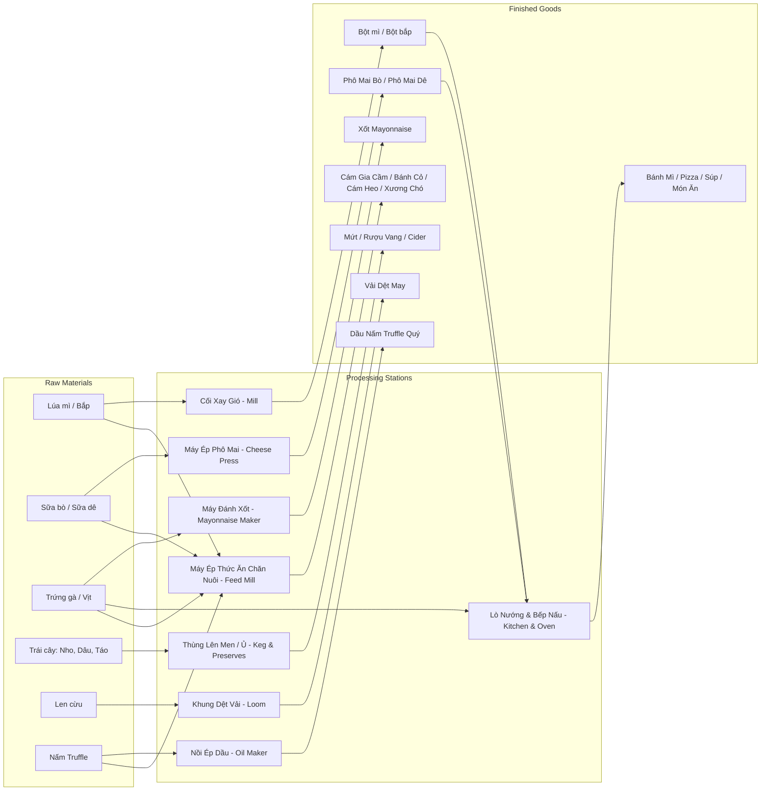

# Farm RPG 2D Game Specification (System Design & Data Schema)

> **Document Type:** Game Design Document & AI Technical Specification  
> **Target Audience:** AI Agents, Game Designers, Full-stack Game Developers  
> **Visual Style:** 2D Cozy Pixel Art (World/Sprites) + Modern Soft/Neo-Glassmorphic UI (Smooth, Rounded, Non-pixelated HUD)  
> **Core Loop:** Cultivate & Raise $\rightarrow$ Harvest Raw Goods $\rightarrow$ Process/Cook (Artisan Pipeline) $\rightarrow$ Sell at Market/Stall $\rightarrow$ Expand Farm & Unlock Tech

---

## 1. System Overview & Core Constants

### 1.1 Time & Calendar System
```yaml
time_system:
  real_seconds_per_game_minute: 0.7  # 1 game hour = 42s real time
  game_hours_per_day: 20             # 06:00 AM to 02:00 AM (Player faints at 02:00)
  real_duration_per_day_seconds: 504 # ~8.4 minutes per in-game day
  days_per_season: 28                # 4 seasons: Spring, Summer, Autumn, Winter
  days_per_year: 112
```

### 1.2 Price & Multiplier Balancing
```yaml
economic_tiers:
  raw_material_base_multiplier: 1.0
  primary_artisan_multiplier: 2.0 - 2.5   # Eg: Wheat -> Flour, Milk -> Butter
  secondary_artisan_multiplier: 3.5 - 5.0 # Eg: Flour + Milk + Egg -> Cake, Aged Wine
  shipping_bin_rate: 1.0                  # Instant bulk sell at day end
  market_stall_rate: 1.25 - 1.40          # Active selling directly to villagers
```

---

## 2. Crops System (Trồng Trọt)

### 2.1 Crop Data Schema
```typescript
interface CropDefinition {
  id: string;
  name: string;
  vietnameseName: string;
  unlockLevel: number;
  seedPrice: number;
  baseSellPrice: number;
  growthDays: number;
  regrowDays: number | null; // null if single harvest
  minYield: number;
  maxYield: number;
  seasons: ("spring" | "summer" | "autumn" | "winter")[];
  stages: number; // visual sprite frames before harvest
  processedInto: string[];
}
```

### 2.2 Crop Database

| ID | Name | Vietnamese Name | Unlock Level | Seed Price | Base Sell Price | Growth Days | Regrow Cycle | Yield | Seasons | Processed Output |
| :--- | :--- | :--- | :---: | :---: | :---: | :---: | :---: | :---: | :--- | :--- |
| `crop_radish` | Radish | Củ cải đỏ | 1 | 15g | 35g | 4 | None (Single) | 1 | Spring, Autumn | Pickled Radish, Salad |
| `crop_wheat` | Wheat | Lúa mì | 1 | 10g | 25g | 4 | None (Single) | 1-2 | Spring, Summer, Autumn | Flour, Animal Feed, Beer |
| `crop_carrot` | Carrot | Cà rốt | 2 | 20g | 48g | 5 | None (Single) | 1 | Spring, Autumn | Carrot Juice, Rabbit Feed |
| `crop_tomato` | Tomato | Cà chua | 2 | 50g | 30g | 6 | 3 days | 1-2 | Summer | Ketchup, Pizza Sauce |
| `crop_corn` | Corn | Bắp ngọt | 3 | 70g | 55g | 8 | 4 days | 1-2 | Summer, Autumn | Corn Flour, Popcorn, Poultry Feed |
| `crop_sunflower`| Sunflower | Hướng dương | 3 | 40g | 80g | 7 | None (Single) | 1 (+Seeds) | Summer, Autumn | Cooking Oil, Flower Bouquet |
| `crop_potato` | Potato | Khoai tây | 4 | 40g | 80g | 6 | None (Single) | 1-3 | Spring | French Fries, Potato Vodka |
| `crop_strawberry`| Strawberry | Dâu tây | 4 | 100g | 120g | 8 | 3 days | 1 | Spring | Strawberry Jam, Strawberry Cake |
| `crop_pumpkin` | Pumpkin | Bí ngô | 5 | 120g | 320g | 12 | None (Single) | 1 | Autumn | Pumpkin Pie, Creamy Pumpkin Soup |
| `crop_grape` | Grape | Nho tím | 6 | 80g | 90g | 10 | 3 days | 2-3 | Autumn | Wine, Raisins, Grape Juice |

### 2.3 Perennial Fruit Trees (Cây Lâu Năm)

| ID | Name | Growth to Mature | Regrow Frequency | Harvest Product | Key Usage |
| :--- | :--- | :---: | :---: | :--- | :--- |
| `tree_apple` | Cây Táo | 20 days | Every 3 days | Apple (Táo tươi) | Apple Cider, Apple Pie |
| `tree_orange`| Cây Cam | 20 days | Every 3 days | Orange (Cam ngọt) | Fresh Orange Juice, Marmalade |
| `tree_coffee`| Cây Cà phê | 15 days | Every 2 days | Coffee Cherry (Hạt cà phê tươi) | Roasted Beans, Hot Espresso (+Speed Buff) |

---

## 3. Livestock & Animals System (Chăn Nuôi)

### 3.1 Animal Data Schema
```typescript
interface AnimalDefinition {
  id: string;
  name: string;
  vietnameseName: string;
  buildingRequired: "coop" | "barn" | "outdoor";
  purchaseCost: number;
  growthToAdultDays: number;
  productCycleDays: number;
  feedType: "wheat" | "hay" | "corn" | "veggies" | "flowers";
  harvestTool: "hand" | "milk_bucket" | "shears" | "forage";
  primaryProduct: string;
  highMoodProduct: string;
  baseProductValue: number;
}
```

### 3.2 Livestock Database

| ID | Name | Building | Purchase Cost | Days to Adult | Product Cycle | Feed | Tool | Harvest Product | High Mood Product | Base Value |
| :--- | :--- | :--- | :---: | :---: | :---: | :--- | :--- | :--- | :--- | :---: |
| `animal_chicken` | Gà mái | Coop (Chuồng gà) | 800g | 4 days | 1 day | Lúa mì / Cám bắp | Hand | Trứng gà thường | Trứng gà lớn (Sao vàng) | 50g / 95g |
| `animal_duck` | Vịt | Coop + Pond | 1,200g | 5 days | 2 days | Bắp / Hạt | Hand | Trứng vịt, Lông vịt | Trứng vịt lộn / Lông tơ cao cấp | 90g / 180g |
| `animal_cow` | Bò sữa | Barn (Chuồng gia súc) | 2,000g | 6 days | 1 day | Cỏ tươi / Cỏ khô (Hay) | Xô vắt sữa | Bình sữa bò tươi | Bình sữa hảo hạng | 120g / 220g |
| `animal_goat` | Dê | Barn | 2,500g | 7 days | 2 days | Cỏ tươi / Hay | Xô vắt sữa | Bình sữa dê | Bình sữa dê thượng hạng | 200g / 360g |
| `animal_sheep` | Cừu | Barn | 3,000g | 6 days | 3 days | Cỏ tươi / Hay | Kéo xén lông | Bụi len cừu thô | Len cừu chất lượng cao | 300g / 550g |
| `animal_pig` | Heo (Lợn) | Barn (Outdoor Yard) | 4,000g | 8 days | 1 day (Khi ra sân) | Rau củ các loại | Heo tự ủi đất | Nấm Truffle (Nấm cục) | Nấm Truffle Vàng | 600g / 1,200g |
| `apiculture_bee` | Ong mật | Beehive (Vườn hoa) | 1,500g (Craft) | Instant | 4 days | Hoa xung quanh | Hand | Mật ong dại | Mật ong theo loài hoa | 100g / 350g |
| `aquaculture_pond` | Ao cá mini | Fish Pond | 2,500g (Build) | 3 days (Thả giống) | 3-5 days | Thức ăn cá | Vợt cá | Cá chép, Tôm ngọt | Trứng cá muối (Roe) | 80g - 400g |

---

## 4. Artisan & Processing System (Chế Biến & Giá Trị Gia Tăng)

### 4.1 Processing Station Schema
```typescript
interface ProcessingRecipe {
  stationId: string;
  recipeId: string;
  name: string;
  inputs: { itemId: string; quantity: number }[];
  output: { itemId: string; quantity: number };
  durationGameHours: number;
  sellPrice: number;
}
```

### 4.2 Stations & Recipe Matrix



### 4.3 Detailed Artisan Recipe Specifications

| Station | Input Ingredients | Output Item | Craft Time (Game Hours) | Base Input Cost | Output Sell Price | Profit Margin |
| :--- | :--- | :--- | :---: | :---: | :---: | :---: |
| **Windmill** | 1x Lúa mì | 1x Bột mì cao cấp | 2h | 25g | 60g | +140% |
| **Windmill** | 1x Hạt cà phê tươi | 1x Bột cà phê rang | 3h | 30g | 80g | +166% |
| **Cheese Press** | 1x Sữa bò tươi | 1x Phô mai vàng | 3h | 120g | 260g | +116% |
| **Cheese Press** | 1x Sữa dê tươi | 1x Phô mai dê béo | 4h | 200g | 480g | +140% |
| **Mayo Maker** | 1x Trứng gà | 1x Lọ sốt Mayonnaise | 2h | 50g | 150g | +200% |
| **Preserves Jar** | 1x Dâu tây + 1x Đường | 1x Hũ mứt dâu | 5h | 140g | 320g | +128% |
| **Preserves Jar** | 1x Củ cải đỏ | 1x Hũ dưa cải muối chua | 4h | 35g | 90g | +157% |
| **Fermentation Keg**| 1x Nho tím | 1x Chai rượu vang ủ | 12h | 90g | 380g | +322% |
| **Fermentation Keg**| 1x Táo đỏ | 1x Rượu táo Cider | 8h | 60g | 220g | +266% |
| **Oil Maker** | 1x Nấm Truffle | 1x Chai dầu nấm Truffle | 6h | 600g | 1,450g | +141% |
| **Oil Maker** | 2x Hạt hướng dương | 1x Chai dầu ăn thực vật | 3h | 80g | 190g | +137% |
| **Loom** | 1x Len cừu thô | 1x Cuộn vải dệt | 4h | 300g | 620g | +106% |

---

### 4.4 Nhà Máy Sản Xuất Thức Ăn Chăn Nuôi (Animal Feed Mill)

> **Mục đích:** Xử lý các loại nông sản thô thành thức ăn tinh chất lượng cao cho từng loài động vật. Cho động vật ăn thức ăn chuyên dụng sẽ tăng sản lượng, rút ngắn thời gian sinh trưởng và nâng cao phẩm cấp sản phẩm (sao vàng/sao tím).

| Mã Thức Ăn | Loài Tiêu Thụ | Công Thức Phối Trộn (Inputs) | Sản Lượng Ra | Thời Gian Ép | Tác Dụng & Buff Cho Vật Nuôi |
| :--- | :--- | :--- | :---: | :---: | :--- |
| `feed_poultry` | **Gà mái & Vịt** | 1x Lúa mì + 1x Bắp ngọt | 3x Cám Gia Cầm | 1.5h | Tăng **+40% tỉ lệ đẻ Trứng Vàng**, vịt rụng lông tơ mềm mại. |
| `feed_cattle` | **Bò, Cừu, Dê** | 2x Cỏ khô (Hay) + 1x Củ cải đỏ | 3x Bánh Cỏ Nén | 2.0h | **Tăng gấp đôi sản lượng sữa** cho bò/dê; cừu mọc lông nhanh hơn 1 ngày. |
| `feed_swine` | **Heo (Lợn)** | 1x Khoai tây + 1x Cà rốt + 1x Bắp | 4x Cám Heo Vỗ Béo | 2.5h | Heo vui vẻ cực độ, tăng **+50% tỉ lệ ủi trúng Nấm Truffle Vàng**. |
| `feed_dog_bone`| **Chó canh nhà** | 1x Bột mì + 1x Cá tươi + 1x Trứng | 3x Xương Thịt Bồi Bổ| 1.0h | Chó luôn tỉnh táo, tăng **+30% tốc độ chạy dí bắt trộm** và x2 tiền phạt cắn trộm. |
| `feed_fish` | **Ao cá** | 1x Cám lúa mì + 1x Dầu hướng dương | 5x Cám Viên Nổi | 1.0h | Cá mau lớn, kích thích sản sinh **Trứng cá muối (Roe)** đắt tiền. |

---

### 4.5 Hệ Thống Nấu Ăn Bếp Gia Đình (Kitchen & Cooking Recipes)

> **Cơ chế Nấu Ăn:** Người chơi nâng cấp Farmhouse lên Cấp 2 sẽ mở khóa Căn Bếp Nấu (Kitchen). Các món ăn chế biến từ nông sản không chỉ bán được giá cao ngất ngưởng ở chợ mà còn mang lại **Buff chỉ số đặc biệt** khi ăn (hồi thể lực, chạy nhanh hơn, tăng may mắn khi đào bới/câu cá).

#### 🥗 Nhóm Món Khai Vị & Ăn Nhẹ (Appetizers & Snacks)
| Món Ăn | Nguyên Liệu Nấu | Thời Gian | Giá Bán Chợ | Tác Dụng Khi Ăn (Buff) |
| :--- | :--- | :---: | :---: | :--- |
| **Salad Nông Trại** | 1x Củ cải đỏ + 1x Cà rốt + 1x Xốt Mayonnaise | 0.5h | 280g | Hồi **+45 Thể Lực**; Tăng tốc chạy **+15%** trong 3 phút. |
| **Súp Bí Ngô Kem** | 1x Bí ngô + 1x Bình sữa bò + 1x Bơ tươi | 1.0h | 620g | Hồi **+90 Thể Lực**; Giảm **25% thể lực tiêu hao** khi cuốc đất/tưới cây trong 5 phút. |
| **Khoai Tây Lốc Xoáy**| 2x Khoai tây + 1x Dầu ăn thực vật | 0.5h | 240g | Hồi **+50 Thể Lực**; Giòn rụm dễ ăn, trẻ con trong làng rất thích. |
| **Bắp Nướng Bơ Mật**| 2x Bắp ngọt + 1x Bơ tươi + 1x Mật ong | 0.8h | 390g | Hồi **+70 Thể Lực**; Tăng **+1 May Mắn (Luck)** khi đào đất và câu cá. |

#### 🍞 Nhóm Bánh Nướng & Tráng Miệng (Bakery & Desserts)
| Món Ăn | Nguyên Liệu Nấu | Thời Gian | Giá Bán Chợ | Tác Dụng Khi Ăn (Buff) |
| :--- | :--- | :---: | :---: | :--- |
| **Bánh Mì Hoa Cúc** | 1x Bột mì + 1x Trứng gà + 1x Sữa tươi | 1.0h | 340g | Hồi **+60 Thể Lực**; Lương thực cơ bản để mang theo đi làm vườn cả ngày. |
| **Bánh Kem Dâu Tây** | 1x Bột mì + 1x Trứng + 1x Bơ + 2x Dâu tây | 1.5h | 890g | Hồi **+120 Thể Lực**; Món tráng miệng xa xỉ, bán chạy nhất chợ phiên cuối tuần. |
| **Bánh Táo Quế Nướng**| 1x Bột mì + 1x Bơ + 2x Táo đỏ + 1x Đường | 1.2h | 580g | Hồi **+85 Thể Lực**; Hương thơm nồng nàn, tăng độ thiện cảm NPC thị trấn. |
| **Bánh Muffin Bí Ngô**| 1x Bột mì + 1x Trứng + 1x Bí ngô + 1x Mật ong | 1.0h | 520g | Hồi **+75 Thể Lực**; Tăng tốc độ thu hoạch nông sản. |

#### 🍲 Nhóm Món Chính No Nê (Hearty Main Courses)
| Món Ăn | Nguyên Liệu Nấu | Thời Gian | Giá Bán Chợ | Tác Dụng Khi Ăn (Buff) |
| :--- | :--- | :---: | :---: | :--- |
| **Pizza Nông Trại** | 1x Bột mì + 1x Xốt cà chua + 1x Phô mai + 1x Nấm Truffle | 1.8h | 1,650g | Hồi **100% Thể Lực**; **Siêu Buff:** Tăng **+25% tốc độ làm việc** và **+20% tốc độ di chuyển** trong 6 phút! |
| **Trứng Cuộn Phô Mai**| 2x Trứng gà + 1x Phô mai dê + 1x Cà chua | 0.8h | 560g | Hồi **+80 Thể Lực**; Vị béo ngậy đậm đà. |
| **Cá Áp Chảo Xốt Cam** | 1x Cá tươi + 1x Bơ tươi + 1x Trái cam vàng | 1.2h | 720g | Hồi **+95 Thể Lực**; Tăng cự ly phát hiện kẻ trộm vào ban đêm. |

#### ☕ Nhóm Đồ Uống Tăng Lực (Artisan Beverages)
| Thức Uống | Nguyên Liệu Nấu | Thời Gian | Giá Bán Chợ | Tác Dụng Khi Ăn (Buff) |
| :--- | :--- | :---: | :---: | :--- |
| **Cà Phê Espresso Đậm**| 1x Bột cà phê rang xay | 0.3h | 210g | **Tăng tốc chạy nước rút (Sprint) +40%** trong 4 phút *(Vũ khí tối thượng để rượt đuổi bắt kẻ trộm!)* |
| **Trà Hoa Mật Ong** | 1x Hoa hướng dương + 1x Mật ong hoa | 0.5h | 320g | Hồi **+55 Thể Lực**; Giúp thư giãn, tăng tốc độ hồi phục Stamina tự nhiên. |
| **Nước Ép Bình Minh** | 1x Dâu tây + 1x Quả cam + 1x Quả táo | 0.5h | 410g | Hồi **+80 Thể Lực**; Giải khát cực sảng khoái vào mùa hè. |

---

## 5. Market & Selling Channels (Hệ Thống Bán Hàng)

```yaml
selling_mechanics:
  shipping_bin:
    type: "Passive"
    description: "Player places any goods into the wooden bin before 02:00 AM."
    payment_time: "Next morning during sunrise cutscene."
    price_rate: 1.0
    risk: "Zero risk, infinite capacity."
  
  farmers_market_stall:
    type: "Active Minigame / Management"
    schedule: "Every Saturday & Sunday (09:00 - 17:00)"
    description: "Player rents a stall at the town plaza and displays processed goods."
    price_rate: 1.30 - 1.50
    mechanics:
      - "Villager NPCs have preferences (eg: Baker loves Flour & Eggs, Mayor loves Wine)."
      - "Haggling minigame (deal slider) to boost price up to +20%."
      - "Daily Market Trends (e.g., 'Rainy Day: Hot Coffee & Soup sell for +50%')."
```

---

## 6. UI/UX Soft Aesthetic Architecture (Phong Cách Giao Diện Mềm Mại)

Để tạo sự đối lập hài hòa tuyệt đối giữa **Pixel World (retro, chi tiết)** và **UI System (mượt mà, cao cấp, không góc cạnh)**:

### 6.1 Design Tokens (CSS / UI Standards)
```css
:root {
  /* Soft Cozy Pastel Palette */
  --bg-modal: rgba(255, 253, 248, 0.88);
  --bg-glass: rgba(255, 255, 255, 0.45);
  --blur-glass: blur(16px);
  
  --primary-accent: #6C9A8B;      /* Sage Green - Natural */
  --secondary-accent: #E76F51;    /* Warm Terracotta - Harvest */
  --cozy-yellow: #F4A261;         /* Warm Sunlight */
  --wood-warm: #8D5B4C;           /* Milk Chocolate Wood */
  --text-main: #2C3531;           /* Deep Charcoal Warm */
  --text-muted: #6B7280;
  
  /* Curvature & Elevations (Soft & Rounded) */
  --radius-sm: 12px;
  --radius-md: 20px;
  --radius-lg: 32px;
  --radius-pill: 9999px;
  
  --shadow-soft: 0 10px 30px -5px rgba(60, 40, 20, 0.08), 0 4px 12px rgba(0, 0, 0, 0.04);
  --shadow-float: 0 20px 40px -10px rgba(78, 52, 28, 0.16);
  
  /* Typography: Modern Rounded Geometric Sans (NEVER Pixel Font for UI text) */
  --font-family: 'Quicksand', 'Nunito', 'Plus Jakarta Sans', sans-serif;
}
```

### 6.2 Key UI Components Behavior
1. **Inventory & Tool Belt**:
   - Khung floating pill bo tròn ở mép dưới màn hình.
   - Slot vật phẩm bo góc `rounded-2xl`, background kính mờ đổi màu pastel nhạt theo loại đồ vật (Xanh: Cây trồng, Vàng: Chăn nuôi, Đỏ/Cam: Thức ăn chế biến).
   - Nút chọn nảy nhẹ (Elastic Bounce / Jelly Effect) khi di chuột.
2. **Shop / Stall Modal**:
   - Khung popup kích thước lớn bo tròn 28px, hiệu ứng mở bung nở nhẹ (`scale(0.95)` lên `scale(1)` trong 200ms easing cubic-bezier).
   - Thanh trượt số lượng (Slider) dạng núm tròn béo mềm (Chubby thumb), dễ kéo thả.
3. **Floating Toast Notifier (Khi nhặt / thu hoạch)**:
   - Viên thuốc nổi (Bubble Pill) bay lên từ đầu nhân vật hoặc góc phải trên, bo tròn 9999px, icon 3D/vector mượt mà hiển thị: `+1 Trứng gà lớn ★`.

---

## 7. Next Steps for Implementation

1. **Data Layer (`src/shared/data/`)**: Khởi tạo các file định nghĩa dữ liệu `crops.json`, `animals.json`, `recipes.json`.
2. **Simulation Engine (`src/client/systems/`)**:
   - `TimeSystem.ts`: Quản lý chu kỳ ngày đêm, giờ giấc, mùa vụ.
   - `FarmGridSystem.ts`: Quản lý các ô đất (cày xới, tưới nước, sinh trưởng cây).
   - `LivestockSystem.ts`: Tính toán ăn uống, tâm trạng, sản sinh sản phẩm.
3. **Presentation Layer (`src/client/ui/`)**:
   - Xây dựng lớp UI DOM/HTML/CSS phủ trên canvas Phaser/Web, tận dụng CSS transitions và Glassmorphism siêu mượt.
