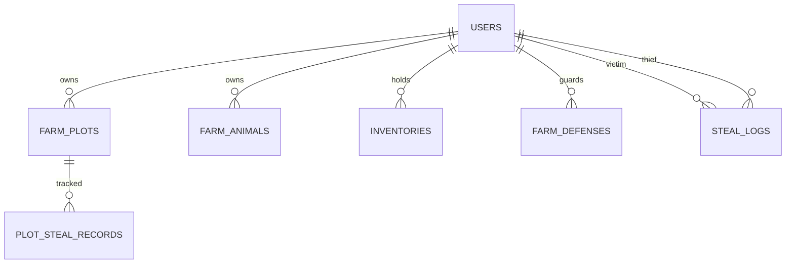

# MASTER SYSTEM PROMPT & ARCHITECTURE SPECIFICATION
## Dự Án: Cozy Farm RPG 2D & Stealth Thievery Online (Node.js + Web)

> **Mục Đích**: Tài liệu này đóng vai trò là **Master Prompt** hoàn chỉnh, chuẩn hóa toàn bộ kiến trúc, cơ sở dữ liệu, logic game và lộ trình thực thi theo 3 tài liệu đặc tả:
> - `DATABASE_AND_ONLINE_SPEC.md` (Cơ sở dữ liệu, Transaction chống Race Condition, Timestamp Growth, Chó canh nhà)
> - `FARM_SYSTEM_SPEC.md` (Hệ thống nông sản, vật nuôi, chế biến Artisan, kinh tế)
> - `STEALTH_CHASE_SYSTEM_SPEC.md` (Cơ chế lén lút trộm nông sản, rượt đuổi thời gian thực, tầm nhìn FOV, dụng cụ)

---

## 1. THIẾT KẾ KIẾN TRÚC TỔNG THỂ (SYSTEM ARCHITECTURE)

### 1.1 Tech Stack Chuẩn Hóa
- **Backend**: Node.js (Express / Fastify) - Kiến trúc modular (Controller - Service - Repository/DB - Middleware).
- **Database**: Relational Database (SQLite / PostgreSQL) tuân thủ 100% ACID Transactions, có Indexing tối ưu cho các truy vấn thời gian thực.
- **Frontend / Client**: Web Browser (HTML5 Canvas + Phaser 3 Arcade Physics + Modern Neo-Glassmorphism UI).
- **Communication Protocol**: RESTful API cho trạng thái nông trại & Socket.io / WebSocket cho pha rượt đuổi thời gian thực.

### 1.2 Nguyên Lý Cốt Lõi (Server-Authoritative)
1. **Timestamp-based Growth (Không Timer Phía Client)**:
   $$\text{CurrentStage} = \min\left(\text{MaxStages}, \left\lfloor \frac{\text{Now} - \text{PlantedAt}}{\text{StageDurationSeconds}} \right\rfloor + 1\right)$$
   Server kiểm soát 100% việc cây đã chín hay chưa. Tránh hack gian lận đồng hồ client.
2. **Anti-Race Condition Khi Ăn Trộm (Double Stealing)**:
   Dùng Database Transaction khóa hàng (`SELECT ... FOR UPDATE` trong PostgreSQL hoặc transaction atomic trong SQLite).
3. **Cơ Chế Bảo Vệ Chủ Nhà**:
   Nông sản chỉ có thể bị trộm tối đa **30% sản lượng gốc** (`max_stealable = floor(original_yield * 0.3)`). Chủ nhà luôn giữ lại ít nhất 70% nông sản.

---

## 2. SCHEMA CƠ SỞ DỮ LIỆU ĐÃ TỐI ƯU & DỄ MỞ RỘNG



### 2.1 Bảng `users` (Người chơi & Nhân vật)
- `id` (UUID/TEXT, PK): Mã định danh duy nhất.
- `username` (VARCHAR(50), UNIQUE): Tên tài khoản đăng nhập.
- `password_hash` (TEXT): Mật khẩu mã hóa BCrypt.
- `character_name` (VARCHAR(50)): Tên hiển thị người nông dân.
- `gender` (VARCHAR(10)): `'male'` hoặc `'female'` (chọn sprite nam/nữ).
- `avatar_url` (TEXT): Đường dẫn ảnh đại diện nhân vật.
- `level` (INT, Default 1): Cấp độ nông trại.
- `exp` (INT, Default 0): Điểm kinh nghiệm tích lũy.
- `gold` (BIGINT, Default 500): Ví tiền vàng khởi điểm.
- `energy` (INT, Default 100): Thể lực hiện tại.
- `max_energy` (INT, Default 100): Giới hạn thể lực tối đa.
- `last_login_at` (TIMESTAMP): Thời gian online gần nhất.
- `created_at` (TIMESTAMP): Ngày tạo tài khoản.

### 2.2 Bảng `farm_plots` (Lưới ô đất trồng trọt)
- `id` (UUID/TEXT, PK)
- `user_id` (UUID/TEXT, FK -> users.id)
- `plot_index` (INT): Vị trí ô (0 đến 15)
- `crop_id` (VARCHAR(50)): ID hạt giống/cây (`crop_wheat`, `crop_strawberry`...) hoặc NULL
- `planted_at` (BIGINT/TIMESTAMP): Timestamp gieo hạt
- `watered_at` (BIGINT/TIMESTAMP): Timestamp tưới nước
- `is_watered` (TINYINT): 1 nếu đã tưới, 0 nếu khô cằn
- `original_yield` (INT): Sản lượng gốc khi chín
- `remaining_yield` (INT): Sản lượng còn lại thực tế
- `stolen_count` (INT): Số lượng đã bị trộm
- `max_stealable` (INT): Giới hạn trộm tối đa (30%)
- `is_harvested` (TINYINT): 0 hoặc 1

### 2.3 Bảng `farm_defenses` (Chó canh nhà & Bẫy)
- `user_id` (UUID/TEXT, PK, FK -> users.id)
- `dog_name` (VARCHAR(50), Default 'Vàng')
- `dog_level` (INT, Default 1): Càng cao tỉ lệ cắn trộm và tiền phạt càng lớn
- `bite_rate` (FLOAT, Default 0.35): 35% xác suất phát hiện & cắn trộm
- `is_fed` (TINYINT, Default 1): No bụng mới bảo vệ
- `bone_count` (INT, Default 5): Lượt bảo vệ còn lại

### 2.4 Bảng `plot_steal_records` & `steal_logs`
- `plot_steal_records`: Khóa chống 1 người spam hái trộm nhiều lần trên cùng 1 luống đất (`UNIQUE(plot_id, thief_id)`).
- `steal_logs`: Ghi nhận lịch sử cho chủ nhà (thời gian, tên kẻ trộm, số nông sản bị mất, tiền phạt kẻ trộm bị chó cắn rớt lại).

### 2.5 Bảng `inventories` (Kho nông sản & Túi đồ)
- `id` (UUID/TEXT, PK)
- `user_id` (UUID/TEXT, FK -> users.id)
- `item_id` (VARCHAR(50)): ID vật phẩm (hạt giống, nông sản, dụng cụ, món ăn)
- `quantity` (INT): Số lượng
- `quality` (INT, Default 1): Phẩm chất (1: Thường, 2: Bạc, 3: Vàng)
- `UNIQUE(user_id, item_id, quality)`

---

## 3. ĐẶC TẢ HOẠT ẢNH NHÂN VẬT (SPRITESHEET LAYOUT)

Các file spritesheet chuẩn lưới 6 cột $\times$ 5 hàng (768 $\times$ 640px, frame 128 $\times$ 128px):
- 👨‍🌾 **Nam**: `/assets/sprites/farmer_male_grid.png`
- 👩‍🌾 **Nữ**: `/assets/sprites/farmer_female_grid.png`

| Hàng (Row) | Hành động (Action) | Số Frame | Chỉ số Frame | Ứng Dụng Gameplay |
| :---: | :--- | :---: | :---: | :--- |
| **Row 0** | **Đứng (Idle)** | 4 | `0` đến `3` | Đứng nghỉ, thở nhẹ, chớp mắt tự nhiên |
| **Row 1** | **Bước đi (Walk)** | 6 | `6` đến `11` | Di chuyển 4 hướng / 8 hướng (FlipX khi sang trái) |
| **Row 2** | **Cuốc đất (Hoe)** | 4 | `12` đến `15` | Xới đất, gieo hạt giống xuống luống |
| **Row 3** | **Tưới nước (Water)** | 4 | `18` đến `21` | Nghiêng bình tưới ẩm đất |
| **Row 4** | **Thu hoạch (Harvest)** | 4 | `24` đến `27` | Hái quả, nhổ củ, nhận nông sản vào giỏ |

---

## 4. LỘ TRÌNH PHÁT TRIỂN & PROMPT THỰC THI (MILESTONES ROADMAP)

### Milestone 1: Nền Tảng Auth, Chọn Nhân Vật Nam/Nữ & Dựng Bản Đồ (ĐÃ HOÀN THÀNH ✅)
- Backend API: Đăng ký, đăng nhập, JWT, mã hóa bcrypt, khởi tạo farm plots & starter kit.
- Database: SQLite/PostgreSQL schema hoàn chỉnh, index tốc độ cao.
- Web Client: Auth modal chọn nhân vật Nam/Nữ với canvas preview thời gian thực.
- Phaser 3 Map: Bản đồ trang trại hoàn chỉnh (Nhà chính, Chuồng bò, Cối xay gió, Ao cá, Giếng nước, Chó canh nhà, Cổng thoát hiểm, 16 ô đất).
- Hotbar tương tác gieo hạt, cuốc đất, tưới nước, thu hoạch.

### Milestone 2: Hệ Thống Cửa Hàng & Chu Trình Nông Sản Đầy Đủ
- **Mục tiêu**: Bổ sung chợ nông sản (Seed Shop & Shipping Bin) và năng lượng hồi phục khi ngủ.
- **Prompt Thực Thi**:
  ```markdown
  Hãy xây dựng hệ thống Cửa Hàng Hạt Giống (Seed Shop) và Thùng Bán Hàng (Shipping Bin) theo FARM_SYSTEM_SPEC.md:
  1. API GET /api/shop/seeds: Lấy danh sách hạt giống theo level của người chơi.
  2. API POST /api/shop/buy: Mua hạt giống trừ tiền vàng, cộng vào túi đồ.
  3. API POST /api/shop/sell: Bán nông sản đã thu hoạch thu về tiền vàng.
  4. Giao diện Web: Modal Shop kính mờ mua bán trực quan với các biểu tượng nông sản.
  5. Đồng hồ chu kỳ ngày đêm: 1 ngày game = 8.4 phút thực tế, chuyển mùa theo lịch.
  ```

### Milestone 3: Hệ Thống Chăn Nuôi & Chế Biến Artisan
- **Mục tiêu**: Nuôi gà, vịt, bò, cừu và chế biến nông sản thành Mayonnaise, Phô mai, Bột mì.
- **Prompt Thực Thi**:
  ```markdown
  Hãy triển khai Hệ thống Chăn Nuôi và Máy Chế Biến theo FARM_SYSTEM_SPEC.md:
  1. Bảng farm_animals: Cho ăn, vuốt ve tăng tim tình cảm, vắt sữa bò, nhặt trứng gà.
  2. Hệ thống công trình Artisan: Cối xay gió (Wheat -> Flour), Máy làm Cheese, Thùng ủ mứt.
  3. Tương tác trên Map: Thả gà đi bộ quanh sân chuồng, click vào bò để vắt sữa.
  ```

### Milestone 4: Cơ Chế Đột Nhập Trộm Nông Sản & Chó Giữ Nhà
- **Mục tiêu**: Cơ chế ghé thăm nông trại bạn bè, hái trộm nông sản, Chó canh nhà sủa và cắn trộm.
- **Prompt Thực Thi**:
  ```markdown
  Hãy xây dựng cơ chế Đột Nhập Đi Trộm theo DATABASE_AND_ONLINE_SPEC.md:
  1. API GET /api/farm/visit/:friendId: Tải bản đồ trang trại của bạn bè.
  2. API POST /api/farm/steal:
     - Transaction khóa hàng chống Double-steal.
     - Kiểm tra giới hạn tối đa 30% sản lượng gốc.
     - Kiểm tra xác suất Chó Cắn (bite_rate = 35%): Phạt tiền kẻ trộm, chuyển tiền phạt cho chủ nhà!
     - Ghi nhận vào steal_logs và plot_steal_records.
  3. UI hiển thị thông báo "Bạn đã hái trộm được..." hoặc "Bạn bị Chó Vàng cắn mất 50G!".
  ```

### Milestone 5: Gameplay Rượt Đuổi Thời Gian Thực (Stealth & Chase)
- **Mục tiêu**: Đấu tay đôi lén lút giữa Kẻ Trộm và Chủ Nhà bằng Phaser 3 Arcade Physics + WebSocket.
- **Prompt Thực Thi**:
  ```markdown
  Hãy lập trình chế độ Đột Nhập Thời Gian Thực theo STEALTH_CHASE_SYSTEM_SPEC.md:
  1. 3 Trạng thái cảnh giác: SAFE (xanh rón rén) -> SUSPICIOUS (vàng '?') -> CHASE (đỏ '!' + rượt đuổi).
  2. Tầm nhìn Cone FOV của Chủ nhà và Chó canh nhà; Núp bụi rơm để ẩn thân.
  3. Cơ chế Sprint tiêu hao thanh Stamina (tốc độ chạy 230 - 245 px/s).
  4. Kho vũ khí & dụng cụ: Chổi đập gây choáng, Súng bắn lưới, Xương dụ chó, Bom khói đào tẩu.
  5. Cổng thoát hiểm Exit Gate: Trộm chạy kịp qua cổng để tẩu thoát thành công.
  ```

---

## 5. CÁCH KHỞI CHẠY & KIỂM THỬ TRÊN MÁY TÍNH

1. **Khởi động server**:
   ```bash
   node server/src/app.js
   # Server lắng nghe tại: http://localhost:3005
   ```
2. **Trải nghiệm trên trình duyệt Web**:
   - Truy cập `http://localhost:3005`.
   - Xem preview động tác Idle của Nông Dân Nam và Nữ.
   - Nhập tên nhân vật, đăng ký và vào ngay game.
   - Di chuyển bằng phím `W, A, S, D` (giữ `Shift` chạy nước rút).
   - Chọn phím số `1 - 6` trên Hotbar:
     - Phím `1`: Cuốc xới đất.
     - Phím `2`: Bình tưới ẩm đất.
     - Phím `3`: Gieo hạt lúa mì.
     - Phím `4`: Gieo hạt cà rốt.
     - Phím `5`: Gieo hạt dâu tây.
     - Phím `6`: Thu hoạch nông sản khi chín!
   - Bấm `E` hoặc `Space` hoặc Click chuột vào ô đất để thao tác.
   - Bấm biểu tượng `🎒` để mở Túi Đồ & Kho Nông Sản.
