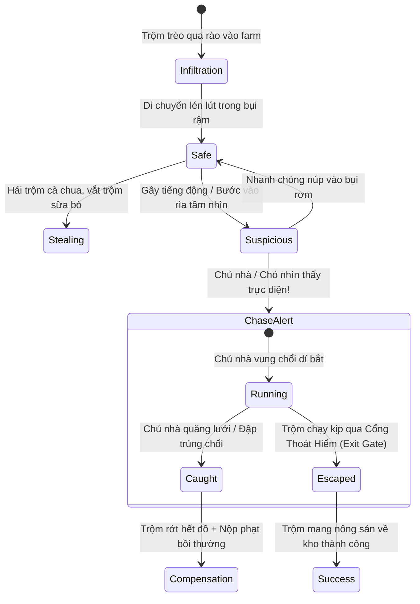

# Stealth & Real-time Chase System Specification (Cơ Chế Lén Lút Đi Trộm & Rượt Đuổi Bắt Trộm)

> **Document Type:** Gameplay Mechanics & Real-time Combat/Chase Specification  
> **Genre Hybrid:** 2D Top-Down Farm RPG + Real-time Stealth/Tag (Trốn tìm & Đuổi bắt)  
> **Engine Compatibility:** Phaser 3 (Arcade Physics / Line of Sight) + WebSocket (Real-time Multiplayer Sync)

---

## 1. Cơ Chế Cốt Lõi: Đột Nhập & Rượt Đuổi (Infiltration & Chase Loop)



### 1.1 Ba Trạng Thái Cảnh Giác (Alert States)
1. **SAFE (An toàn - Xanh)**:
   - Kẻ trộm di chuyển chậm, ẩn mình sau bụi cây, chuồng trại.
   - Tốc độ di chuyển: 80% (rón rén).
2. **SUSPICIOUS (Nghi ngờ - Vàng `?`)**:
   - Khi kẻ trộm chạy nhanh gây tiếng bước chân hoặc lọt vào rìa tầm nhìn (Peripheral Vision) của chủ nhà hoặc chó.
   - Chủ nhà/Chó quay đầu về hướng phát ra tiếng động và bước tới kiểm tra.
3. **CHASE / BÁO ĐỘNG ĐỎ (`!` Đỏ + Chuông reng)**:
   - Kẻ trộm bị phát hiện trực diện.
   - Màn hình chủ nhà nhấp nháy đỏ, nhạc nền chuyển sang tiết tấu đuổi bắt dồn dập.
   - **Tốc độ chạy nước rút (Sprint)**: Cả 2 bên được tăng tốc 130% nhưng tiêu hao thanh Thể lực (Stamina Bar).

---

## 2. Kho Dụng Cụ Cho Kẻ Trộm (Thief Infiltration Arsenal)

| Dụng Cụ (Gadget) | Biểu Tượng | Loại | Hiệu Ứng Chi Tiết | Giá Mua Chợ Đen |
| :--- | :---: | :---: | :--- | :---: |
| **Xương Dụ Chó (Bone Lure)** | 🦴 | Tiêu hao (Ném) | Ném vào tầm nhìn của Chó canh nhà. Chó sẽ ngậm gặm xương trong **10 giây**, hoàn toàn mất cảnh giác và không sủa. | 50g |
| **Giày Rón Rén (Stealth Boots)** | 👟 | Trang bị chân | Loại bỏ hoàn toàn vòng sóng âm thanh bước chân khi chạy nhanh trên đất sỏi/bãi cỏ. | 500g (Dùng bền) |
| **Bom Khói Thoát Thân (Smoke Bomb)** | 💨 | Tiêu hao (Kích hoạt nhanh) | Tạo một vùng khói mù bán kính 4 tile trong **4 giây**. Làm mù tầm nhìn của chủ nhà và chó; kẻ trộm được tàng hình trong làn khói để đổi hướng chạy. | 120g |
| **Móc Dây Vượt Rào (Grappling Hook)**| 🪝 | Dụng cụ | Cho phép trèo qua các đoạn tường đá hoặc hàng rào gỗ bị khóa để đột nhập từ góc khuất thay vì đi cửa chính. | 800g |
| **Thuốc Nước Tăng Tốc (Stamina Rush)**| ⚡ | Nước uống | Hồi đầy 100% thanh thể lực ngay lập tức và tăng tốc độ chạy +40% trong 5 giây để đào tẩu. | 80g |
| **Bao Tải Đáy Sâu (Greedy Sack)** | 🎒 | Túi đựng | Cho phép trộm cùng lúc **3 quả** trong một lần thao tác (thay vì 1 quả), nhưng làm giảm 10% tốc độ di chuyển khi túi đầy. | 600g |

---

## 3. Kho Dụng Cụ Bắt Trộm Cho Chủ Nhà (Farm Defender Arsenal)

| Dụng Cụ (Weapon/Trap) | Biểu Tượng | Loại | Hiệu Ứng Chi Tiết | Giá Mua Cửa Hàng |
| :--- | :---: | :---: | :--- | :---: |
| **Chổi Rơm Gia Truyền (Stun Broom)** | 🧹 | Vũ khí cận chiến | Đánh cận chiến (Phạm vi 1.5 tile). Đập trúng kẻ trộm sẽ **làm choáng (Stun) trong 2.5 giây** để chủ nhà áp sát còng tay. | Miễn phí (Khởi đầu) |
| **Súng Bắn Lưới (Capture Net Gun)** | 🕸️ | Vũ khí tầm xa | Bắn tấm lưới chụp tầm xa 6 tile. Nếu trúng, trói chặt kẻ trộm tại chỗ trong **3.5 giây**, trộm không thể di chuyển hay dùng đồ. | 1,200g |
| **Bẫy Bùn Lầy (Mud Snare Trap)** | 🍯 | Bẫy ẩn đặt dưới đất | Đặt ngụy trang dưới các luống dâu tây/bắp. Khi kẻ trộm giẫm vào: giảm tốc **70% trong 4 giây** và phát ra tiếng "Bép!" báo vị trí trên mini-map. | 90g/cái |
| **Dây Còi Báo Động (Tripwire Bell)** | 🔔 | Công trình phòng thủ | Căng dây chuông ở cổng rào hoặc chuồng bò. Kẻ trộm bước qua sẽ kích hoạt chuông reo vang toàn bản đồ nông trại. | 350g |
| **Đèn Pin Rọi Đêm (Mega Flashlight)** | 🔦 | Trang bị cầm tay | Tăng góc nón tầm nhìn (FOV) từ 60 độ lên 120 độ và cự ly nhìn đêm gấp đôi, phát hiện trộm từ rất xa. | 650g |
| **Còi Huýt Lệnh Chó (Dog Whistle)** | 📯 | Dụng cụ chỉ huy | Thổi còi ra lệnh cho Chó canh nhà lập tức lao thẳng tới vị trí kẻ trộm với tốc độ cực nhanh (+50% speed). | 900g |

---

## 4. Cơ Chế Bồi Thường & Phạt Khi Bị Bắt (Compensation & Penalty Economics)

### 4.1 Khi Chủ Nhà Bắt Được Kẻ Trộm (Tóm sống thành công)
1. **Thu Hồi Toàn Bộ Nông Sản**:
   - 100% số nông sản kẻ trộm vừa hái lén trong lượt đột nhập này sẽ rơi vãi tại chỗ $\rightarrow$ Chủ nhà nhặt lại cất vào kho.
2. **Tiền Phạt Bồi Thường Trực Tiếp (Direct Compensation)**:
   - Kẻ trộm bị cưỡng chế trừ một khoản tiền phạt:
     $$\text{Tiền Bồi Thường} = \max\left(200\text{g}, \text{Tổng giá trị nông sản định trộm} \times 2.0\right) + (\text{Level Chủ Nhà} \times 20\text{g})$$
   - Số tiền này được **cộng thẳng vào ví tiền của chủ nhà** ngay trên màn hình (hiệu ứng xu vàng bay lấp lánh).
3. **Hình Phạt Kẻ Trộm**:
   - Bị "Áp giải về đồn / Đuổi khỏi trang trại", hồi sinh tại nhà mình.
   - Nhận hiệu ứng bất lợi: **Kiệt Sức (Exhausted)** - Giảm 50% thanh thể lực trong 1 ngày game.
   - Tên và avatar của kẻ trộm bị ghi vào **Bảng Thông Báo Tội Phạm** của thị trấn.

### 4.2 Khi Kẻ Trộm Tẩu Thoát Thành Công (Qua Cổng Exit Gate)
- Kẻ trộm giữ nguyên vẹn toàn bộ nông sản trộm được mang về trang trại mình để chế biến ra thành phẩm bán chợ.
- Nhận thêm điểm kinh nghiệm **Đạo Tặc (Thief EXP)** để mở khóa các kỹ năng lén lút cao cấp.
- Màn hình chủ nhà hiện thông báo: *"Kẻ trộm [Tên] đã cao chạy xa bay cùng 3 quả dâu tây của bạn!"*.

---

## 5. Trí Tuệ Nhân Tạo Khi Chủ Nhà Offline (Offline Guard AI)

Khi chủ nhà không trực tiếp online:
- Game tự động chuyển sang chế độ **"NPC Chủ Nhà / Chó Tuần Tra" (Patrol AI)**.
- NPC chủ nhà và Chó đi tuần tra theo các điểm cố định (Waypoints) xung quanh vườn cây và chuồng trại.
- Nếu phát hiện kẻ trộm, NPC chủ nhà tự động chuyển sang trạng thái rượt đuổi, tự động vung chổi hoặc còi gọi chó.
- Tiền phạt khi NPC bắt được trộm sẽ được lưu vào hòm thư, hôm sau chủ nhà online mở thư nhận tiền bồi thường!

---

## 6. Đặc Tả Kỹ Thuật Cho Phaser 3 & Arcade Physics

```typescript
// Định nghĩa thông số vật lý cho pha rượt đuổi trong Phaser 3
export const CHASE_PHYSICS_CONFIG = {
  thief: {
    sneakSpeed: 100,      // Đi rón rén
    normalSpeed: 160,     // Đi bình thường
    sprintSpeed: 230,     // Chạy nước rút (tốn stamina)
    staminaMax: 100,
    staminaDrainPerSec: 15,
    staminaRegenPerSec: 10,
    smokeBombDurationMs: 4000
  },
  owner: {
    normalSpeed: 170,     // Chủ nhà quen địa hình nên đi nhanh hơn một chút
    sprintSpeed: 245,
    meleeRangePx: 48,     // Tầm quét của chổi
    netRangePx: 200,      // Tầm bắn của súng lưới
    stunDurationMs: 2500  // Thời gian trộm bị choáng
  },
  guardDog: {
    patrolSpeed: 120,
    chaseSpeed: 260,      // Chó chạy nhanh nhất trang trại
    visionAngleDeg: 75,
    visionDistancePx: 180
  }
};
```
